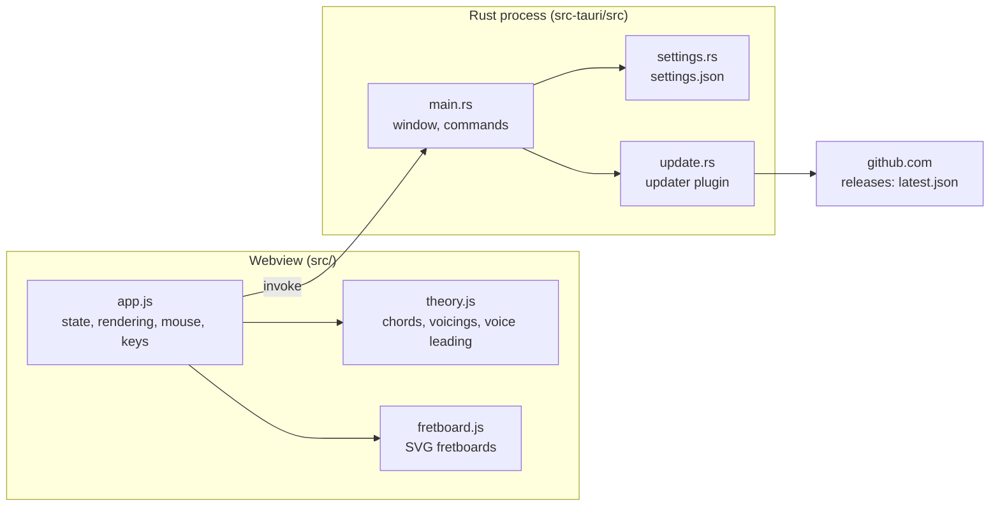

# Architecture

Jazz Guitar Helper is a [Tauri 2](https://v2.tauri.app/) app, built like Unified Mail. The UI is static HTML/CSS/JS rendered by the operating system's webview (WebView2 on Windows, WKWebView on macOS), and it does all the work: reading chord symbols, finding voicings and drawing the fretboard. The Rust process only creates the window, keeps the saved state in a file, opens the links in Settings in the browser, and checks for and installs updates. Its only network connection is to GitHub, for those updates.

## Files

| File | Responsibility |
| --- | --- |
| `src/index.html` | The sidebar (brand, progression, Add chords and its suggestions, Presets, My presets, Settings), the toolbar, the fretboards' pane, Settings, the toast, the Windows window buttons |
| `src/styles.css` | Theme tokens (light, dark), layout, the fretboard's colors (see [ui.md](ui.md)) |
| `src/app.js` | One `state` object, rendering, events, saving through Rust or localStorage, the title bar |
| `src/theory.js` | Pure music theory with no DOM: qualities, spelling, drop voicings, voice leading, chord symbols and all their notes, scales over chords, lengths, ready-made progressions (see [theory.md](theory.md)) |
| `src/fretboard.js` | SVG markup for a board, its notes and voicing shapes, and the fret numbers (see [ui.md](ui.md#fretboard)) |
| `src/staff.js` | SVG markup for the progression on a staff (see [ui.md](ui.md#staff)) |
| `src-tauri/src/main.rs` | Creates the window in the saved theme, with the app's own title bar; the commands |
| `src-tauri/src/settings.rs` | `Store`: reads and writes `settings.json` |
| `src-tauri/src/update.rs` | `check_update` and `install_update`, and on macOS opening the app again after an update (see [development.md](development.md#updates)) |
| `src-tauri/build.rs` | tauri-build, and a rebuild when `icons/icon.ico` changes |
| `tests/theory.test.mjs` | Tests for `theory.js`, run by Node (`npm test`) |
| `tests/release.test.mjs` | Tests for the release version rule in `scripts/next-version.mjs` |
| `scripts/serve.mjs` | Serves `src/` for trying the page in a browser (see [development.md](development.md#trying-the-page-in-a-browser)) |
| `scripts/screenshots.mjs` | Renders the README's screenshots in headless Edge or Chrome (see [development.md](development.md#screenshots)) |
| `scripts/icons.mjs` | Makes `src-tauri/icons/` from `app-icon.svg`, the Windows icon scaled to fill its square (see [development.md](development.md#app-icon)) |
| `scripts/changelog.mjs`, `next-version.mjs`, `set-version.mjs` | The Release workflow's version and notes, as in Unified Mail, with TorrStream Lite's version rule (see [development.md](development.md#releases-github-actions)) |

## Commands (UI → Rust)

All return `Result<_, String>` or a value. The error strings are shown to the user as they are.

| Command | Args | Returns |
| --- | --- | --- |
| `load_state` | | `{ theme, ui }`: `system`, `light` or `dark`, and the page's state as it last saved it (null at first) |
| `save_ui` | `ui` | Saves the page's state. Rust keeps it as JSON without reading it |
| `set_theme` | `theme` | Sets the window's theme and saves it |
| `open_external` | `url` | Opens a link from Settings in the default browser, with the `open` crate as in Unified Mail. Only `https:` links |
| `check_update` | | The newer version on GitHub, or null. The update found is kept in `PendingUpdate` |
| `install_update` | | Downloads it, checks its signature against `plugins.updater.pubkey`, installs it and restarts (on Windows the installer starts the app again) |

There are no events. The one plugin, `tauri-plugin-updater`, is used only from Rust, so it needs no capability permissions. The page uses the `window` API for its own title bar (`core:window:allow-start-dragging`, `allow-minimize`, `allow-toggle-maximize`, `allow-close` in `capabilities/default.json`) and `app.getVersion` for Settings.

When `window.__TAURI__` is missing (the page in a plain browser), `app.js` saves to `localStorage` instead, the theme only sets `data-theme` on the page, links open in a new tab, and there are no updates to check.

## Storage

| Data | Where | Format |
| --- | --- | --- |
| Appearance and the page's state | `<app data>/settings.json` | `{ "theme": "system", "ui": { ... } }`; missing fields get defaults, an unreadable file gives the defaults |

`ui` is what `app.js` keeps in `state.ui`: the chords (`{ id, root: { letter, acc }, quality, role, text, approx, hidden, beats, scale }`, `scale` only once one is chosen), the progression's name that Save offers (`title`), My presets (`saved`: `{ id, name, chords }`, the chords without `id` and `hidden`, and `nextPresetId`), the key for Presets, voicings or Chord tones (`mode`), the drop type, the chosen string sets per drop type, the inversions, labels, view, each view's height (`heights`, px between strings), voice leading, All notes (`allNotes`), Scales (`scales`), the staff (`staff`, and `staffShows`: chords or scales), the metronome (`bpm`, `countIn`, `loop`, `click`, `follow`), the chords' sound (`sound`: off, pluck or a pad, and `space`, `volume`, `bass`), the pins (chord id → voicing id) and the chord voice leading starts from (`anchor`), and the fretboard settings (frets, left-handed, open strings). `sanitize()` checks each field when it's read, so a file from an older or newer version still opens.

The page saves 300 ms after the last change. The file is written to `settings.json.tmp` and then renamed, so a crash can't leave half a file.

`<app data>` is `%APPDATA%\com.andeliseev.jazz-guitar-helper` on Windows and `~/Library/Application Support/com.andeliseev.jazz-guitar-helper` on macOS. The test app (`npm run dev`) uses `com.andeliseev.jazz-guitar-helper.devtest`, so trying things doesn't touch the progression in an installed copy.

## Design decisions

- **The theory lives in the page.** Voicings are a few hundred small computations per change; JavaScript does them instantly, and the page then needs nothing from Rust to draw. It also means the page runs in a plain browser for testing, and could one day be a web version.
- **`theory.js` is pure.** No DOM, no state: functions from chords to voicings. Node runs its tests directly, with no build step or test framework (`node:test`).
- **No frontend framework, no bundler**, as in Unified Mail. `src/` is served as is (`frontendDist`), as ES modules.
- **SVG, drawn as markup.** A board is one `innerHTML` assignment; hovering and pinning only toggle classes (`restyle`), so the mouse never redraws anything.
- **Small binary.** Besides Tauri, only `serde`, `open` and the updater, the updater with the OS's own TLS rather than its default rustls; the release profile is tuned for size (see [development.md](development.md#size-budget)).
- **Errors are `String`s**, written for people, as in Unified Mail.
