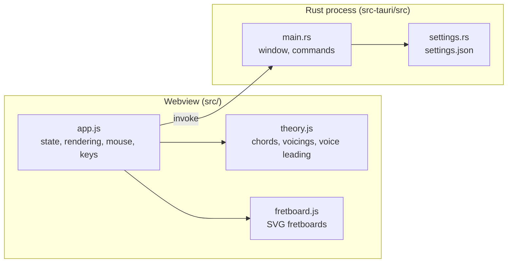

# Architecture

Jazz Guitar Drop Helper is a [Tauri 2](https://v2.tauri.app/) app, built like Unified Mail. The UI is static HTML/CSS/JS rendered by the operating system's webview (WebView2 on Windows, WKWebView on macOS), and it does all the work: reading chord symbols, finding voicings and drawing the fretboard. The Rust process only creates the window and keeps the saved state in a file. The app makes no network connections.

## Files

| File | Responsibility |
| --- | --- |
| `src/index.html` | The sidebar (brand, progression, Add chords, Quick add, Settings), the toolbar, the fretboards' pane, Settings, the toast, the Windows window buttons |
| `src/styles.css` | Theme tokens (light, dark), layout, the fretboard's colors (see [ui.md](ui.md)) |
| `src/app.js` | One `state` object, rendering, events, saving through Rust or localStorage, the title bar |
| `src/theory.js` | Pure music theory with no DOM: qualities, spelling, drop voicings, voice leading, chord symbols, ready-made progressions (see [theory.md](theory.md)) |
| `src/fretboard.js` | SVG markup for a board, its notes and voicing shapes, and the fret numbers (see [ui.md](ui.md#fretboard)) |
| `src-tauri/src/main.rs` | Creates the window in the saved theme, with the app's own title bar; the three commands |
| `src-tauri/src/settings.rs` | `Store`: reads and writes `settings.json` |
| `tests/theory.test.mjs` | Tests for `theory.js`, run by Node (`npm test`) |
| `scripts/serve.mjs` | Serves `src/` for trying the page in a browser (see [development.md](development.md#trying-the-page-in-a-browser)) |
| `scripts/screenshots.mjs` | Renders the README's screenshots in headless Edge or Chrome (see [development.md](development.md#screenshots)) |
| `scripts/changelog.mjs`, `next-version.mjs`, `set-version.mjs` | The Release workflow's version and notes, as in Unified Mail (see [development.md](development.md#releases-github-actions)) |

## Commands (UI → Rust)

All return `Result<_, String>` or a value. The error strings are shown to the user as they are.

| Command | Args | Returns |
| --- | --- | --- |
| `load_state` | | `{ theme, ui }`: `system`, `light` or `dark`, and the page's state as it last saved it (null at first) |
| `save_ui` | `ui` | Saves the page's state. Rust keeps it as JSON without reading it |
| `set_theme` | `theme` | Sets the window's theme and saves it |

There are no events and no plugins. The page uses the `window` API for its own title bar (`core:window:allow-start-dragging`, `allow-minimize`, `allow-toggle-maximize`, `allow-close` in `capabilities/default.json`) and `app.getVersion` for Settings.

When `window.__TAURI__` is missing (the page in a plain browser), `app.js` saves to `localStorage` instead and the theme only sets `data-theme` on the page.

## Storage

| Data | Where | Format |
| --- | --- | --- |
| Appearance and the page's state | `<app data>/settings.json` | `{ "theme": "system", "ui": { ... } }`; missing fields get defaults, an unreadable file gives the defaults |

`ui` is what `app.js` keeps in `state.ui`: the chords (`{ id, root: { letter, acc }, quality, role, text, approx, hidden }`), the key for Quick add, the drop type, the chosen string sets per drop type, the inversions, labels, view, voice leading, the pins (chord id → voicing id) and the chord voice leading starts from (`anchor`), and the fretboard settings (frets, left-handed, open strings). `sanitize()` checks each field when it's read, so a file from an older or newer version still opens.

The page saves 300 ms after the last change. The file is written to `settings.json.tmp` and then renamed, so a crash can't leave half a file.

`<app data>` is `%APPDATA%\com.andeliseev.jazz-guitar-drop-helper` on Windows and `~/Library/Application Support/com.andeliseev.jazz-guitar-drop-helper` on macOS. The test app (`npm run dev`) uses `com.andeliseev.jazz-guitar-drop-helper.devtest`, so trying things doesn't touch the progression in an installed copy.

## Design decisions

- **The theory lives in the page.** Voicings are a few hundred small computations per change; JavaScript does them instantly, and the page then needs nothing from Rust to draw. It also means the page runs in a plain browser for testing, and could one day be a web version.
- **`theory.js` is pure.** No DOM, no state: functions from chords to voicings. Node runs its tests directly, with no build step or test framework (`node:test`).
- **No frontend framework, no bundler**, as in Unified Mail. `src/` is served as is (`frontendDist`), as ES modules.
- **SVG, drawn as markup.** A board is one `innerHTML` assignment; hovering and pinning only toggle classes (`restyle`), so the mouse never redraws anything.
- **Small binary.** No plugins and only `serde` besides Tauri; the release profile is tuned for size (see [development.md](development.md#size-budget)).
- **Errors are `String`s**, written for people, as in Unified Mail.
